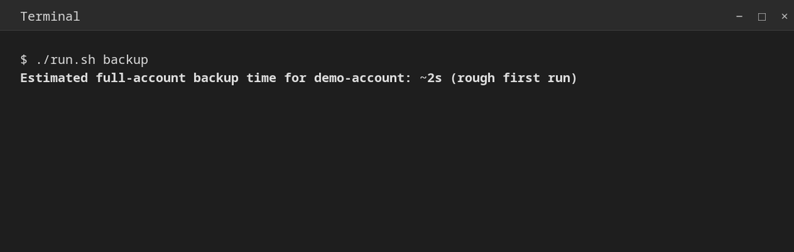

# Discord Backup Linux

Encrypted Discord account backups and guided recovery on Linux. Inspired by [ItsChasa's Discord-Backup](https://github.com/itschasa/Discord-Backup).

[Build v1.8.0](builds/v1.8.0) · [Unlock a backup](UNLOCK_BACKUP.md) · [Usage and commands](docs/USAGE.md) · [Changelog](CHANGELOG.md)



*Demo with synthetic data. [View the menu](builds/v1.8.0/screenshots/menu.png) · [View a partial backup](builds/v1.8.0/screenshots/warnings.png)*

## Install

On Arch Linux, install the dependencies and run from source.

```sh
sudo pacman -S --needed python gnupg python-requests
git clone https://github.com/EasyAntiCheatSoftware/discord-backup-linux.git
cd discord-backup-linux
./run.sh
```

Other Linux distributions need Python 3.10+, GnuPG 2.4+ and Requests. For a desktop shortcut, run `python3 tools/install_desktop.py`. To build an Arch package, run `./build-arch.sh`. [Arch build and install steps](builds/v1.8.0)

## Back up or recover

- **1 · Back up account.** Choose Discord app scanning, optional browser scanning or hidden token entry. Save memberships, contacts, profile data, folder and GIF settings, and optional invites. Keep the passphrase to unlock the file. The app estimates the whole run before backing up and updates the ETA on one line.
- **2 · Recover a backup.** Choose a recent file or enter a path. Export a local recovery page, publish links through your own bot, or preview settings restores. Server joins and friend requests are manual. [Bot setup and limits](docs/RECOVERY_HUB.md)
- **Partial backups** preserve data collected so far in an encrypted `-partial.bkup` file. Recovery shows which sections are missing. [How to unlock on Linux, macOS or Windows without the app](UNLOCK_BACKUP.md)

Backups default to `~/.local/share/discord-backup-linux/backups`. Use `./run.sh --help` for all commands, including offline inspection, scheduled backups and diagnostics. [Backup contents, storage and advanced usage](docs/USAGE.md)

> This unofficial app uses normal account tokens and private endpoints. Discord prohibits normal-account automation and may terminate accounts that use it. [Discord policy](https://support.discord.com/hc/en-us/articles/115002192352-Automated-User-Accounts-Self-Bots)

[Contributing and tests](CONTRIBUTING.md) · [Architecture](docs/ARCHITECTURE.md) · [Review notes](docs/REVIEW.md) · [Builds](docs/RELEASING.md) · [Security](SECURITY.md) · [License](LICENSE) · [Attribution](NOTICE)
