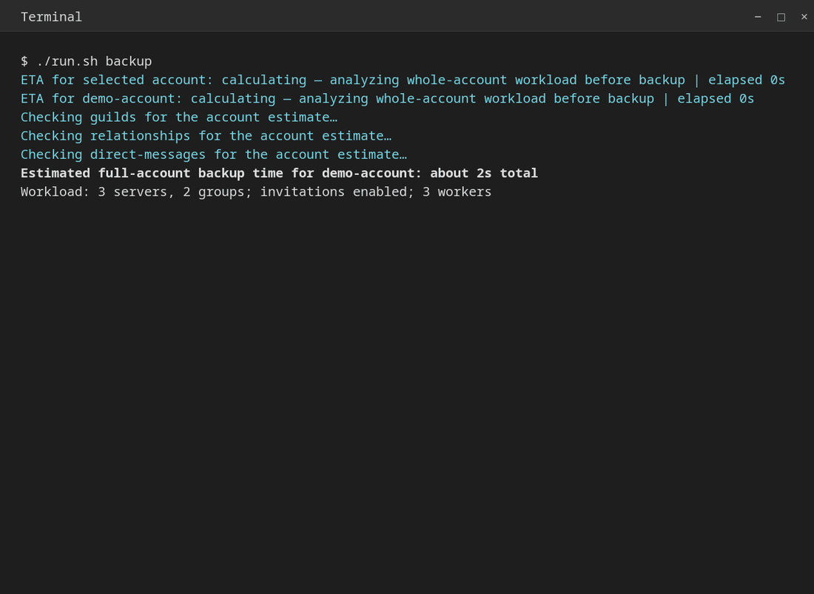

<div align="center">

# Discord Backup Linux

Encrypted Discord account backups and guided recovery for Linux.

[](https://github.com/EasyAntiCheatSoftware/discord-backup-linux/actions/workflows/check.yml)

[](LICENSE)

**[Install](#install) · [Download](builds/v1.7.0) · [Unlock a backup](UNLOCK_BACKUP.md) · [Bot setup](docs/RECOVERY_HUB.md)**

</div>



*Real CLI output with synthetic data, captured independently of personal desktop and terminal settings. [Static preview](builds/v1.6.0/screenshots/backup.png).*

This independent Linux reimplementation is **inspired by [ItsChasa's Discord-Backup](https://github.com/itschasa/Discord-Backup)**.

> This unofficial app uses normal account tokens and private Discord endpoints. [Discord prohibits automating normal user accounts](https://support.discord.com/hc/en-us/articles/115002192352-Automated-User-Accounts-Self-Bots); using it can lead to account termination.

## Install

On Arch Linux:

```sh
sudo pacman -S --needed python gnupg python-requests
git clone https://github.com/EasyAntiCheatSoftware/discord-backup-linux.git
cd discord-backup-linux
./run.sh
# Optional desktop shortcut:
python3 tools/install_desktop.py
```

Requires **Python 3.10+, GnuPG 2.4+ and Requests**. On other Linux distributions, install those dependencies through your package manager. This is not a Windows app; standalone decryption also works on Windows and macOS.

[Version 1.7.0](builds/v1.7.0) includes the full source archive, an Arch package and `SHA256SUMS`. Verify with `sha256sum -c SHA256SUMS`, then install with `sudo pacman -U ./discord-backup-linux-1.7.0-1-any.pkg.tar.zst`. Packages are unsigned: checksums verify consistency, not publisher identity. To build from source, run `./build-arch.sh` as your normal user.

## Back up

Choose **1 — Back up account**, scan your local Discord caches or enter a token in a hidden prompt, then choose and confirm a passphrase of at least 12 characters. Browser-profile scanning requires opt-in. Interactive use does not save credentials.

Keep the passphrase separately: there is no reset or recovery key. Backups normally go to `~/.local/share/discord-backup-linux/backups`; use `--output` for another folder.

| Saved data | Recovery |
| --- | --- |
| Server/group membership and optional invitations | Follow saved invitations manually |
| Friends, blocked users, requests and open-DM contacts | Open profiles and manage relationships manually |
| Profile images and bio | Export files, then apply them in Discord |
| Server folders | Preview/apply for servers you have rejoined |
| Favourite GIF/frecency settings | Optional replacement of the entire opaque settings block |

Message contents and server contents are not collected. The original project's plaintext JSON backups can also be opened.

### Progress and interruptions

One **whole-account estimate** appears after read-only preparation and before the main backup. The overall ETA adjusts to observed invite throughput, encryption and Discord waits. Future estimates use up to five recent private timing samples for that account and the same worker/invite options. The cache contains numeric timings, no tokens or backup contents; see [storage details](docs/USAGE.md#timing-history). A first run cannot know future Discord throttles and is labeled accordingly.

Repeated rate-limit notices are grouped across workers, with at most one update every 30 seconds. The ETA still shows known waits; the final summary retains throttle counts, total wait time and every missing-data warning. Request pacing, retry limits and collected data are unchanged.

An unfinished file keeps **`-partial.bkup`** in its name. Completed collection removes that suffix only after the final encrypted save. Partial backups remain usable: the app, recovery page and decrypted JSON identify missing/pending sections. Ordinary interruption forces a save and preserves successful in-flight invite results. A forced kill, power loss or disk/encryption failure can preserve only the last successful checkpoint. Missing data needs a new backup; files cannot be resumed.

## Recover — here or on another machine

Choose **2 — Recover / restore a backup**. The picker checks current/default folders and the last folder used in this session; you can also enter a custom folder or file. Unlock once, then choose a local recovery page, private bot hub or settings restore.

- **With the app:** the local recovery page contains saved links, profile files, section status and warnings. Its output is decrypted personal data; keep the folder private.
- **Without the app:** use GnuPG 2.4+ and the same passphrase. [The unlock guide](UNLOCK_BACKUP.md) includes Linux/macOS and Windows commands that show partial status after decryption. No Discord token or original computer is needed.
- **Bot recovery:** your own bot organizes links and contacts in private channels in an existing trusted server. Review the destination before typing `PUBLISH`. Server owners/admins can read uploaded data. [Setup and limits](docs/RECOVERY_HUB.md).

Server joins, friend requests and profile changes remain manual, as in the original project. The bot is not a universal CAPTCHA-free account restore.

Settings restores preview first and save an encrypted rollback before writing. Folder restore keeps current-only memberships; GIF restore replaces the whole frecency block, including other preferences stored there. A different account requires explicit confirmation. See [restore details](docs/USAGE.md#settings-restores).

## Commands

Use `discord-backup` instead of `./run.sh` after installing the Arch package.

```sh
./run.sh backup --no-invites       # Read-only backup; default backup mode also creates invites
./run.sh backup --manual          # Hidden manual token entry
./run.sh backup --output "$HOME/Backups/Discord"
./run.sh recover                  # Recent-file picker and recovery menu
./run.sh recover /path/to/backups # Browse a custom folder
./run.sh inspect /path/to/file.bkup
./run.sh export /path/to/file.bkup --output "$HOME/discord-recovery"
./run.sh --help
```

Invalid choices repeat the prompt. Yes/no accepts `y`/`yes` or `n`/`no`; Enter uses the displayed default. Restore confirmations require the exact uppercase word, or Enter to cancel.

[Advanced usage](docs/USAGE.md) covers account scanning, settings restores, encryption/storage, scheduled backups, colors, speed tests and exit codes. [Changelog](CHANGELOG.md) lists release changes.

## Development

```sh
python3 -m unittest discover -s tests -v
python3 tools/release.py --check
python3 tools/release.py
```

Tests use synthetic accounts/transports, temporary files and real GnuPG; CI checks Python 3.10 and 3.14. See [architecture](docs/ARCHITECTURE.md), [review notes](docs/REVIEW.md), [releasing](docs/RELEASING.md), [contributing](CONTRIBUTING.md) and [security reports](SECURITY.md).

Licensed under [AGPL-3.0-only](LICENSE). [NOTICE](NOTICE) records the upstream attribution and licensing basis. Discord and ItsChasa do not endorse this project.
