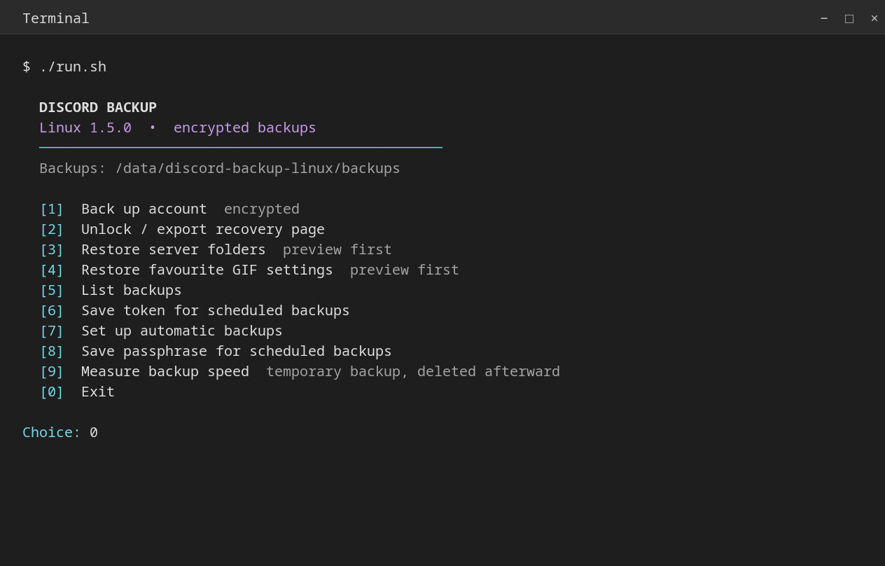
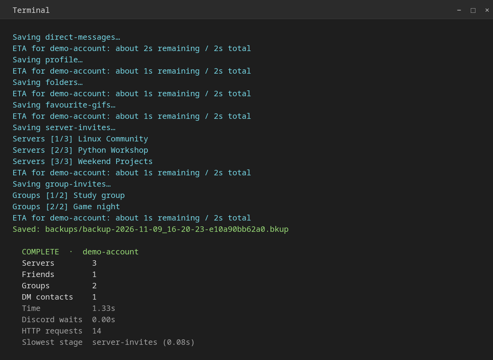
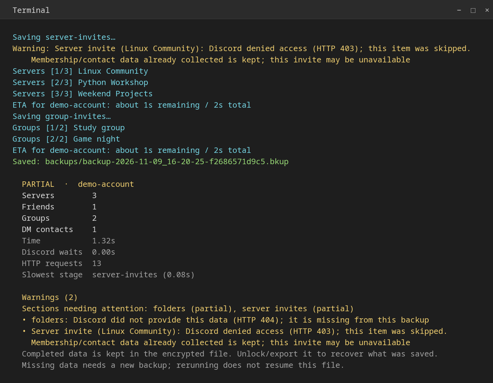

<div align="center">

# Discord Backup Linux

### Back it up. Keep it encrypted. Recover it anywhere.

A terminal app for encrypted Discord account backups and offline recovery.

[](https://github.com/EasyAntiCheatSoftware/discord-backup-linux/actions/workflows/check.yml)


[](LICENSE)

**[Quick start](#start-on-arch-linux) · [Download](builds/v1.5.0) · [Unlock a backup](UNLOCK_BACKUP.md) · [Commands](#commands)**

</div>



*Actual program output captured in an isolated terminal and rendered with a neutral theme. All accounts and data shown are synthetic; no personal desktop, terminal settings or account information are captured.*

This independent Linux reimplementation is **inspired by [ItsChasa's Discord-Backup](https://github.com/itschasa/Discord-Backup)**. Run it from source or install the Arch package. It needs **Python 3.10+, GnuPG 2.4+ and Requests**.

| Back up | See what's happening | Recover |
| --- | --- | --- |
| Encrypted account data, contacts, profile assets and optional invites | Account-specific ETA, colored progress, rate-limit waits and a readable warning summary | Local recovery page, profile files and encrypted rollback before settings restores |

> **Account automation:** this app uses normal account tokens and private Discord endpoints. [Discord prohibits automating normal user accounts](https://support.discord.com/hc/en-us/articles/115002192352-Automated-User-Accounts-Self-Bots), which can lead to account termination. Rate-limit handling does not remove that risk. This project is unofficial.

## Start on Arch Linux

```sh
sudo pacman -S --needed python gnupg python-requests
git clone https://github.com/EasyAntiCheatSoftware/discord-backup-linux.git
cd discord-backup-linux
./run.sh
```

The menu offers cache scanning or hidden manual token entry. A backup then asks for a passphrase of at least 12 characters and confirmation. Keep that passphrase: there is no reset or recovery key.

For a first read-only backup:

```sh
./run.sh backup --no-invites
```

Without `--no-invites`, the app also creates server and group invitations where permitted. Membership, contacts, and settings are saved before that phase, so an invitation failure leaves those completed sections in an encrypted partial backup.

On another Linux distribution, install Python, GnuPG 2.4+, and Requests through its package manager. Alternatively, install Requests in a virtual environment with `python3 -m pip install -r requirements.txt`, activate it, and run `./run.sh`. The application itself requires Linux filesystem semantics; it is not a Windows port.

### Desktop launcher

```sh
python3 tools/install_desktop.py
```

This creates **Discord Backup** in the desktop directory reported by `xdg-user-dir DESKTOP`, with a fallback to `~/Desktop`. It opens the colored terminal menu. Keep the source directory in place, or regenerate the launcher after moving it. A recognized older launcher named `Discord Backup.sh` is archived locally to remove the duplicate icon.

### Arch package

A complete package and matching source archive are kept under [builds/v1.5.0](builds/v1.5.0). Check `SHA256SUMS` in that directory before installing. Packages are unsigned; checksums detect a damaged or mismatched download, not the identity of its publisher.

To build locally instead:

```sh
sudo pacman -S --needed base-devel python gnupg python-requests
./build-arch.sh
sudo pacman -U dist/arch/discord-backup-linux-1.5.0-1-any.pkg.tar.zst
discord-backup
```

Run the build as your normal user. `makepkg` checks the generated source checksum and runs the offline tests. Only installation needs root. The package adds `/usr/bin/discord-backup` and an application-menu entry; it does not create credentials or enable timers. This repository is not an AUR submission.

## Watch the backup, not a blank terminal



After reading the selected account's memberships, the app estimates remaining time and total duration from its server/group counts, enabled invitation work, worker count, observed request latency and measured encryption cost. It updates the estimate at section boundaries and during invitations. Known invite cooldowns and the switch to serial requests are included. There is no fixed estimate shared across all accounts and no extra request or stored account-history file for this feature.

The estimate is a guess: new throttles, retries, slow downloads or denied invite permissions can change it. If membership discovery fails, the app says the estimate is unavailable rather than inventing a complete-account ETA.

<details>
<summary><strong>What a partial backup looks like</strong></summary>



The final summary lists each warning, affected sections and unattempted work. Permission errors identify the missing item; invite failures explain that membership/contact data is kept. Completed data remains encrypted and usable. Unlock/export the file to recover it; missing sections need a new backup. Interrupted runs print the same warning summary before the error/path.

</details>

## Unlock your backup — here or on another machine

| With this app | Without this app |
| --- | --- |
| Choose **2 — Unlock / export recovery page**, select the `.bkup`, and enter its passphrase. Or use `inspect` / `export`. Works on the same machine or another Linux machine. | Use **GnuPG 2.4+** on Linux, macOS or Windows. Remove the eight-byte wrapper and decrypt with the same passphrase. No Discord token or original machine is needed. |

**[Read the complete unlock guide →](UNLOCK_BACKUP.md)** — includes menu steps, terminal commands, Windows PowerShell, partial backups and troubleshooting. Keep the guide with your encrypted files and the passphrase separately.

## Contents and recovery

| Data | Saved | Recovery |
| --- | --- | --- |
| Servers | Membership, names, IDs, vanity links and optional invitations | Follow invitations; rejoining is manual |
| Relationships | Friends, blocked users, incoming/outgoing requests, available names | Open profiles and manage relationships manually |
| Group chats | Names, IDs, recipients, optional invitations | Follow an invitation while it remains valid |
| DM contacts | Open-DM contacts and last message IDs | Open profiles manually; message contents are not saved |
| Profile | Avatar/banner image bytes and bio | Export files and apply them in Discord |
| Server folders | Names, colors, folder IDs and server order | Preview and apply for currently joined servers |
| Favourite GIFs | Opaque `settings-proto/2` frecency block | Optional replacement of the entire block |

The app reads legacy plaintext JSON `.bkup` files from the original program. Newly written backups encrypt the entire JSON payload and include timestamps, section results, warnings, and timings. The original Windows program cannot read this encrypted format. A backup cannot recover expired invitations, deleted data, lost membership, or messages it never collected. There is no automatic joining or friend-request replay.

## Commands

<details open>
<summary><strong>Everyday commands</strong></summary>

Use `discord-backup` instead of `./run.sh` after installing the Arch package.

```sh
./run.sh                         # Terminal menu
./run.sh backup                  # Account selection, encrypted backup, optional invite writes
./run.sh backup --scan
./run.sh backup --manual
./run.sh backup --no-invites      # No account writes
./run.sh backup --workers 1       # Start invite requests serially
./run.sh backup --output "$HOME/Backups/Discord"
./run.sh scan
./run.sh scan --scan-browsers
./run.sh list
./run.sh inspect /path/to/backup.bkup
./run.sh export /path/to/backup.bkup --output "$HOME/discord-recovery"
./run.sh restore-folders /path/to/backup.bkup
./run.sh restore-folders /path/to/backup.bkup --apply
./run.sh restore-gifs /path/to/backup.bkup
./run.sh restore-gifs /path/to/backup.bkup --apply
./run.sh encrypt /path/to/legacy.bkup
./run.sh --help
```

</details>

`inspect` and `export` work offline. They ask for the backup passphrase, never a Discord token. Export requires a new output directory and creates a local HTML page, bio text, and recognized image files. It contains **decrypted personal data**. The page has no JavaScript or remotely loaded images; links open Discord when followed. Invalid legacy image data produces a warning.

Restore commands preview by default. `--apply`, or typing `APPLY` in the menu, authorizes the write. Before writing, the app checks the live account and saves a separate encrypted rollback snapshot. It reads settings back before reporting a verified restore. Folder restoration retains currently joined servers absent from the backup and omits servers you have not rejoined. The menu stops if its displayed folder plan changes before applying. Concurrent changes during the final request can still race; avoid editing the same settings elsewhere during restoration.

A different account requires `--allow-different-account`. To reverse a restore, preview the corresponding restore command with its `rollback-*.bkup` file. GIF restoration replaces the **whole opaque frecency block**, including other preferences stored there. A changed or normalized server response is reported as unconfirmed rather than silently declared successful.

`encrypt` writes a separate encrypted copy of a plaintext legacy file. The original remains plaintext until you remove it yourself.

### Account scanning

Scanning reads current-user native/Flatpak Discord-family LevelDB caches, including supported Vesktop, ArmCord, and Legcord locations. It skips symlinks and files owned by another user, bounds individual reads and total input to 256 MiB, and validates at most 50 unique candidate tokens. Duplicate accounts are combined. Candidate validation uses `/users/@me`; the UI prints account/client labels, never token values.

Chrome, Chromium, Brave, and Edge caches require `--scan-browsers` or the menu's opt-in prompt. Additional LevelDB directories can be selected with repeatable `--scan-path` options. The scanner recognizes ordinary and legacy MFA tokens, but cannot read every compressed or OS-keyring-encrypted record. It does not unlock keyrings. Use manual entry when scanning finds no valid account.

### Colors

Colors are automatic on a terminal and off for redirected output, `TERM=dumb`, or `NO_COLOR`. Use `--color always` or `--color never` before the command to override detection. The desktop launcher enables colors. `inspect` outputs ordinary JSON.

## Encryption and storage

Backups normally live in `~/.local/share/discord-backup-linux/backups`; an absolute `$XDG_DATA_HOME` changes the data root. Names contain a UTC timestamp and random suffix. New directories use mode `0700`; new backup/export files use `0600`. Existing parent permissions are unchanged.

The file format is an eight-byte `DBLENC1\n` header followed by a binary password-encrypted OpenPGP message. GnuPG uses AES-256/OCB authenticated encryption, salted iterated SHA-512 passphrase derivation, and an S2K count of 65,011,712. See the [GnuPG OpenPGP options](https://www.gnupg.org/documentation/manuals/gnupg/OpenPGP-Options.html). The passphrase travels through a private inherited pipe, not command arguments or environment variables. GnuPG uses an isolated temporary home and no symmetric-key cache.

Plaintext JSON exists in process memory. Backup and rollback writes encrypt before writing to an atomic temporary file; encryption failure never falls back to plaintext. Decryption must complete with authenticated status checks before the app accepts its output. This does not isolate data from other processes already running as your user or prevent the OS from swapping memory.

**You can unlock a backup on another machine without this app.** Keep [UNLOCK_BACKUP.md](UNLOCK_BACKUP.md) with the encrypted file and retain its passphrase separately. It covers GnuPG on Linux/macOS and Windows. No Discord token or original computer is required.

### Unattended backups

Interactive use does not save either credential. The following commands explicitly save plaintext credentials protected by filesystem permissions:

```sh
./run.sh save-token
./run.sh save-passphrase
./run.sh backup --token-file "$HOME/.config/discord-backup-linux/token" \
  --passphrase-file "$HOME/.config/discord-backup-linux/backup-passphrase" --no-invites
./run.sh schedule
# Review the generated units, then enable:
systemctl --user daemon-reload
systemctl --user enable --now discord-backup.timer
systemctl --user list-timers discord-backup.timer
```

Defaults respect an absolute `$XDG_CONFIG_HOME`. Both files must be regular files owned by you without group/other permission bits; final-component symlinks are rejected. Save commands refuse to replace existing files. Keep the passphrase file separate when copying backups off the machine.

The timer runs after user-manager startup and daily with jitter, while the user manager is available. Scheduled backups are read-only unless generated with `schedule --create-invites`. Units bind absolute paths; regenerate them after moving a source installation. The app does not enable the timer automatically. Disable with `systemctl --user disable --now discord-backup.timer`. There is no automatic backup retention or cleanup.

## Rate limits, errors, and speed

Each worker reuses its own HTTPS connection pool. Three workers process independent invitation tasks by default; `--workers` accepts 1–4. A shared coordinator reserves known request budgets, separates major resources, handles global limits and fractional reset deadlines, and follows [Discord's rate-limit headers](https://docs.discord.com/developers/topics/rate-limits). A local guard caps request starts at 25 per second; it is not a claim about the rate Discord allows.

An invitation 429 pauses the invite route across channels, reduces it to one in-flight request, and adds exponential backoff. Longer server retry delays take precedence. Queued work stops on invalid credentials, CAPTCHA requirements, five persistent 429 responses for a request, or a required cooldown above 120 seconds. Requests already in flight may finish. GETs have bounded server-error retries; invite POSTs are not repeated after ambiguous network/server failures. The app does not bypass limits or solve CAPTCHAs.

If you see `Discord rate limit persisted`, let the cooldown expire, then try `backup --workers 1` or `backup --no-invites`. The reported partial file remains encrypted and can be inspected/exported normally. Rerunning creates a new backup; it does not resume an old one. Unsupported optional endpoints create warnings and a partial result.

Encrypted checkpoints occur at section boundaries and approximately every five seconds during invitations, rather than after every invitation. Ordinary cancellation and handled request errors force a final save. A forced process kill, power loss, or disk/encryption failure can preserve only the last successful checkpoint. Timings exclude the final checkpoint's own write and include summed worker HTTP time, which can exceed elapsed time.

```sh
./run.sh speed-test --no-invites   # Real account, temporary local ciphertext
./run.sh speed-test               # Also creates invitations where allowed
python3 tools/benchmark_network.py --latency 0.12  # Synthetic, offline, 1 vs 3 workers
python3 tools/benchmark.py         # Synthetic encrypted-checkpoint workload
```

`speed-test` deletes its own local test files on success, exceptions, and ordinary cancellation. It does not remove invitations created on Discord or touch existing backups. Forced termination may leave unreadable temporary ciphertext. The offline benchmark uses fixture data, simulated latency and real encryption; it does not establish live performance or speed relative to the original Windows tool.

Exit codes: `0` success, `1` error or interrupted backup, `2` partial backup/export warnings, `130` cancellation outside the backup collection flow. A partial scheduled result appears as a failed service while retaining its encrypted file.

## Development and review

```sh
python3 -m unittest discover -s tests -v
python3 tools/release.py --check
python3 tools/release.py
```

Tests use synthetic accounts and transports, temporary files, and real GnuPG. They do not need a Discord account. CI runs the offline suite with Python 3.10 and 3.14. See [architecture](docs/ARCHITECTURE.md), [review notes](docs/REVIEW.md), [release procedure](docs/RELEASING.md), and [contributing](CONTRIBUTING.md).

The 1.4.0 baseline received a source security review and targeted bug fixes before publication. Version 1.5.0 adds per-account time estimates, detailed end-of-run warnings and the screenshot/unlock documentation. No confirmed security vulnerability was identified in the reviewed pre-fix source. This is not a guarantee of safety. The application is tested offline on Arch Linux; live Discord backup/restore behavior was not verified during the release review. CI results for Python 3.10 and 3.14 are linked in the badge above.

## License and attribution

AGPL-3.0-only; see [LICENSE](LICENSE) and [NOTICE](NOTICE). The upstream source headers and repository license label differ; NOTICE records the basis used here. Discord and ItsChasa do not endorse this project.
